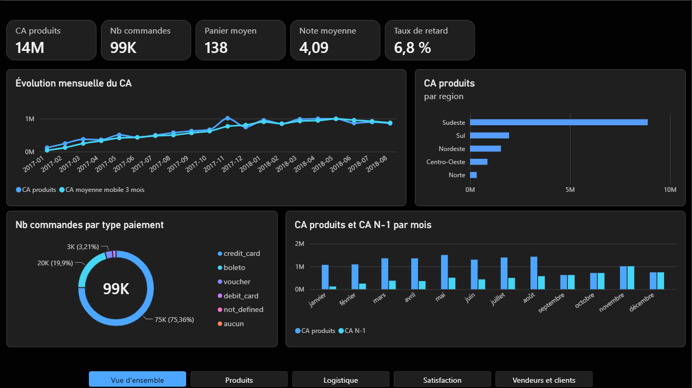
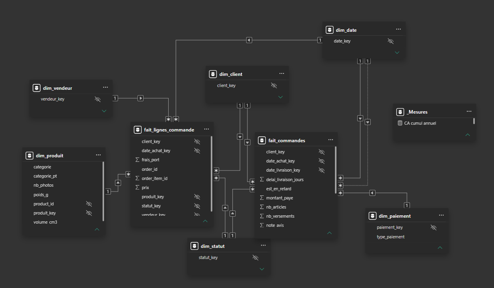
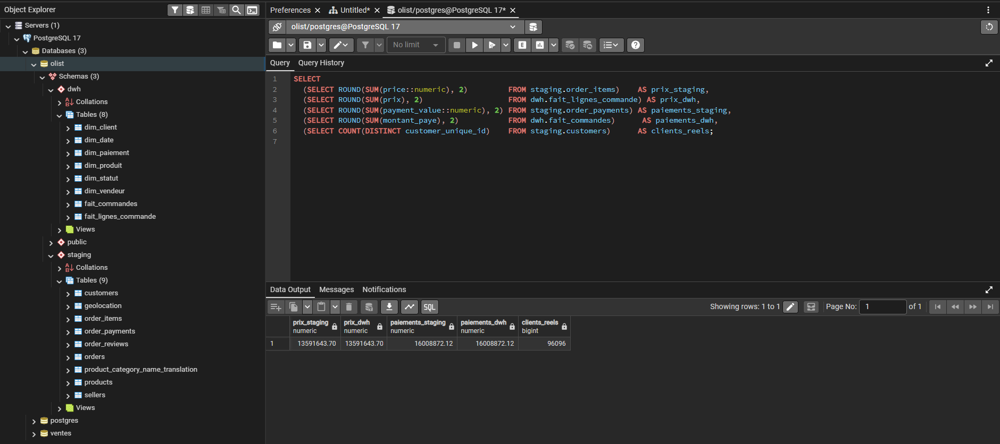

# Dashboard e-commerce Olist · PostgreSQL, modèle en étoile et Power BI

J'ai construit ce projet de bout en bout pour mon portfolio Data Analyst / BI. Je pars d'un jeu de données brut de 1,5 million de lignes et j'arrive à un dashboard Power BI de 5 pages. Entre les deux, un entrepôt PostgreSQL en modèle en étoile, alimenté par un ETL Python, et des KPI que j'ai tous vérifiés en SQL.

**Mes rapports d'analyse :** [🇫🇷 Français](docs/rapport_analyse_fr.md) · [🇬🇧 English](docs/analysis_report_en.md)

> **English summary.** I built this end-to-end BI project on the Olist Brazilian e-commerce dataset (99k orders, 2016–2018). I load the raw CSV files into PostgreSQL, model them as a star schema with a Python ETL, and analyse them in Power BI with 34 DAX measures, each checked against a SQL reference value. Main findings: revenue grew +137% year on year, late deliveries cut the review score from 4.3 to 2.3, and 20% of sellers make 83% of revenue. Full details in my [English report](docs/analysis_report_en.md).



## Ce que j'ai trouvé

| | |
|---|---|
| **13,59 M R$** de CA produits · **99 441** commandes · **96 096** clients | **+137 %** de CA (janvier-août 2018 contre 2017) |
| Note **4,29/5** à temps contre **2,27/5** en retard | Délai moyen **10,8 j** dans le Sudeste contre **22,6 j** dans le Norte |
| **20 %** des vendeurs font **83 %** du CA | **3,1 %** de clients récurrents seulement |

## Pourquoi ce projet

*[À compléter : ce qui t'a donné envie de faire ce projet, pourquoi ce dataset, ce que tu voulais montrer.]*

## Architecture

```
data/raw/*.csv ──► staging (copie brute) ──► ETL Python ──► dwh (étoile) ──► Power BI
  9 fichiers       load_staging.py           transform_load.py   8 tables      34 mesures DAX
                                                   │
                                     contrôles automatiques + valeurs de référence SQL
```

**Stack :** Python 3.10+ (pandas, SQLAlchemy, psycopg2) · PostgreSQL 17 · Power BI Desktop (DAX, Power Query)

## Mes choix de modélisation



| Table | Grain | Contenu |
|---|---|---|
| `fait_lignes_commande` | 1 article (112 650 lignes) | prix, frais de port |
| `fait_commandes` | 1 commande (99 441 lignes) | montant payé, délai, retard, note d'avis, type de paiement |
| `dim_date` | 1 jour | calendrier 2016-2018 |
| `dim_client` | 1 client réel | `customer_unique_id`, ville, État, région, coordonnées |
| `dim_vendeur` | 1 vendeur | ville, État, région, coordonnées |
| `dim_produit` | 1 produit | catégorie (anglais et portugais), poids, photos |
| `dim_statut` | 1 statut | delivered, shipped, canceled… |
| `dim_paiement` | 1 type | credit_card, boleto, voucher, debit_card |

- **J'identifie les clients par `customer_unique_id`.** Dans les données Olist, `customer_id` change à chaque commande : l'utiliser aurait fait disparaître les clients récurrents.
- **J'ai séparé deux tables de faits à des grains différents.** Paiements et avis sont propres à une commande. Les joindre au grain article aurait dupliqué les montants. Je les agrège donc au grain commande.
- **J'utilise des clés substitutives entières**, avec un membre « inconnu » (clé `-1`) dans chaque dimension, pour ne perdre aucune ligne de fait.
- **La date de livraison est une relation inactive**, que j'active en DAX avec `USERELATIONSHIP` quand j'analyse par date de livraison.
- **J'utilise `TREATAS`** pour que les filtres produit et vendeur s'appliquent aussi à la note et au retard, mesurés au grain commande.

## Le dashboard (5 pages)

| Page | Question à laquelle elle répond | Aperçu |
|---|---|---|
| Vue d'ensemble | Combien vend-on, et comment cela évolue-t-il ? | [capture](docs/images/01_vue_ensemble.png) |
| Produits | Quelles catégories portent le CA ? | [capture](docs/images/02_produits.png) |
| Logistique | Où et quand livre-t-on en retard ? | [capture](docs/images/03_logistique.png) |
| Satisfaction | Qu'est-ce qui fait baisser la note ? | [capture](docs/images/04_satisfaction.png) |
| Vendeurs et clients | Qui vend, qui achète, où ? | [capture](docs/images/05_vendeurs_clients.png) |

## Comment j'ai vérifié les chiffres

- [`docs/rapport_qualite.md`](docs/rapport_qualite.md) : avant toute transformation, j'ai profilé les données brutes (valeurs manquantes, doublons, incohérences).
- `etl/transform_load.py` compare staging et entrepôt après chaque chargement : sommes des prix et des paiements, nombre d'articles et de commandes, unicité des commandes et des clients.
- [`docs/valeurs_reference.md`](docs/valeurs_reference.md) : pour chaque KPI, j'ai calculé la valeur attendue en SQL. Chaque mesure DAX doit l'afficher à l'identique.



Les autres captures PostgreSQL (schémas, diagramme ERD, volumes, requêtes d'analyse) sont dans mon [rapport d'analyse](docs/rapport_analyse_fr.md#vérification-dans-postgresql).

## Difficultés rencontrées

*[À compléter : les problèmes que tu as rencontrés et comment tu les as résolus.]*

## Ce que j'ai appris

*[À compléter : les compétences que ce projet t'a fait progresser.]*

## Structure du dépôt

```
olist-dashboard/
├── data/raw/                  # 9 CSV Kaggle (non versionnés)
├── etl/
│   ├── db.py                  # connexion PostgreSQL (lit .env) et chargement COPY
│   ├── test_connexion.py      # test de connexion
│   ├── check_raw.py           # présence et volume des CSV
│   ├── explore_raw.py         # rapport qualité des données brutes
│   ├── load_staging.py        # CSV vers le schéma staging
│   ├── run_sql.py             # exécute un fichier SQL
│   ├── transform_load.py      # ETL staging vers dwh, avec contrôles
│   └── verify.py              # valeurs de référence des KPI
├── sql/
│   ├── 00_create_schemas.sql
│   ├── 01_create_dwh.sql      # modèle en étoile (tables, clés, index)
│   └── 02_verifications.sql   # une requête de contrôle par KPI
├── powerbi/
│   └── olist_dashboard.pbix   # le dashboard
├── docs/
│   ├── rapport_analyse_fr.md  # rapport d'analyse (français)
│   ├── analysis_report_en.md  # analysis report (English)
│   ├── installation.md        # reproduire le projet
│   ├── mesures_dax.md         # les 34 mesures DAX
│   ├── rapport_qualite.md     # qualité des données brutes
│   ├── valeurs_reference.md   # valeurs SQL de référence
│   └── images/                # captures du dashboard et de PostgreSQL
├── .env.example               # modèle du fichier d'identifiants
└── requirements.txt
```

## Reproduire le projet

```powershell
python -m venv .venv
.venv\Scripts\activate
python -m pip install -r requirements.txt
copy .env.example .env        # puis renseigner le mot de passe PostgreSQL

python -m etl.test_connexion
python -m etl.check_raw
python -m etl.load_staging
python -m etl.run_sql sql/01_create_dwh.sql
python -m etl.transform_load
python -m etl.verify
```

Ouvrez ensuite `powerbi/olist_dashboard.pbix` et actualisez. Toutes les étapes et leurs vérifications sont détaillées dans [`docs/installation.md`](docs/installation.md).

## Données

[Brazilian E-Commerce Public Dataset by Olist](https://www.kaggle.com/datasets/olistbr/brazilian-ecommerce), sous licence CC BY-NC-SA 4.0. Les fichiers ne sont pas inclus dans ce dépôt.

## Auteur

**[Ton nom complet]** · Data Analyst / BI

- GitHub : [@Saidbenou](https://github.com/Saidbenou)
- LinkedIn : [ton profil](https://www.linkedin.com/in/[ton-identifiant])

N'hésitez pas à me contacter pour échanger sur ce projet.
