# Olist: sales, logistics and customer satisfaction analysis

*Analysis report · **[Your full name]** · Data: Olist Brazilian E-Commerce (Kaggle) · Amounts in Brazilian reais (R$); revenue is item price excluding shipping*

[Version française](rapport_analyse_fr.md) · [README](../README.md)

---

## 1. Summary

Olist is a Brazilian marketplace that connects small sellers with consumers. The dataset covers **99,441 orders** placed from September 2016 to October 2018, for **R$ 13.59 M** in product revenue.

My five main findings:

1. **Growth is strong.** Revenue for January–August 2018 is **2.4 times** that of the same period in 2017 (+137%).
2. **Late deliveries destroy satisfaction.** Orders delivered on time average a **4.29/5** review score; late orders average **2.27/5**.
3. **Geography drives delivery times.** 74% of sellers are in the Southeast region. A customer in the North waits **22.6 days** on average, against **10.8 days** in the Southeast.
4. **Revenue is highly concentrated.** **20% of sellers** generate **83% of revenue**.
5. **Customers rarely come back.** Only **3.1%** of customers placed more than one order.

## 2. Data and method

| Step | Tool | Output |
|---|---|---|
| Raw data | 9 Kaggle CSV files | 1.55 million rows, including 1 million geolocation rows |
| Data quality | Python (pandas) | [rapport_qualite.md](rapport_qualite.md) (in French) |
| Staging | PostgreSQL 17 | raw copy of the 9 files |
| Warehouse | Python ETL into the `dwh` schema | star schema: 6 dimensions, 2 fact tables |
| Checks | SQL | 6 automated checks and reference values for every KPI |
| Reporting | Power BI, 34 DAX measures | 5-page dashboard |

My key modelling decisions:

- **A real customer is a `customer_unique_id`.** `customer_id` changes with every order. Using it would give 99,441 "customers" instead of 96,096 and hide repeat purchases entirely.
- **Two fact tables.** `fait_lignes_commande` is at item grain (112,650 rows) and holds revenue, categories and sellers. `fait_commandes` is at order grain (99,441 rows) and holds payments, delivery times and reviews. Payments and reviews are never joined at item grain, so no amount is ever counted twice.
- **I checked every DAX measure** against an independent SQL query ([valeurs_reference.md](valeurs_reference.md)).
- **Analysis period: January 2017 to August 2018.** The 2016 months and September–October 2018 contain only a handful of orders. They produce extreme values, such as an average score of 1.0 in September 2016 from a single order.

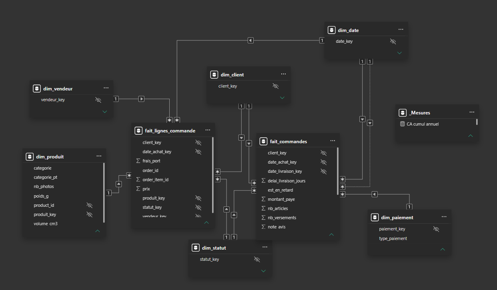

### Checks in PostgreSQL

The database has two schemas: `staging` holds the raw copy of the 9 files, `dwh` the 8-table star schema.

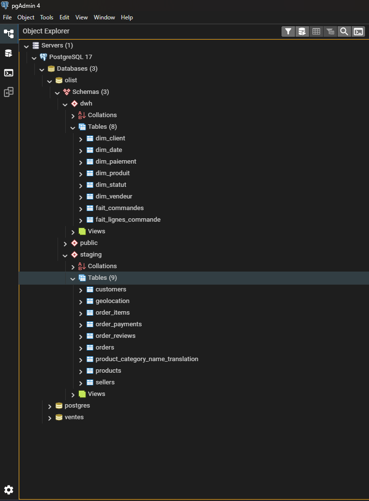

The pgAdmin diagram shows the foreign keys actually declared in the database. Both fact tables point to the same dimensions, and `fait_commandes` links twice to `dim_date` (purchase date and delivery date).

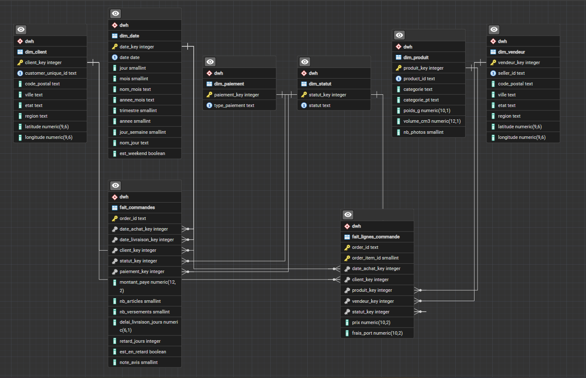

**No rows lost.** Staging and warehouse contain the same number of orders (99,441) and items (112,650). `dim_client` has 96,097 rows: the 96,096 real customers plus the "unknown" member.

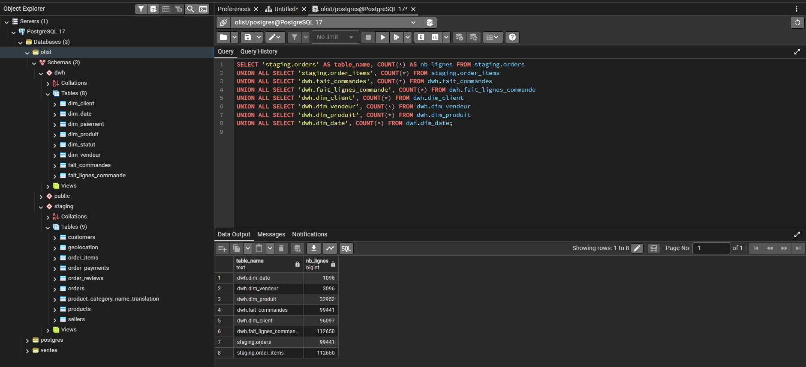

**No amount lost or duplicated.** Total item price (R$ 13,591,643.70) and total payments (R$ 16,008,872.12) are identical before and after transformation. There are 96,096 real customers.

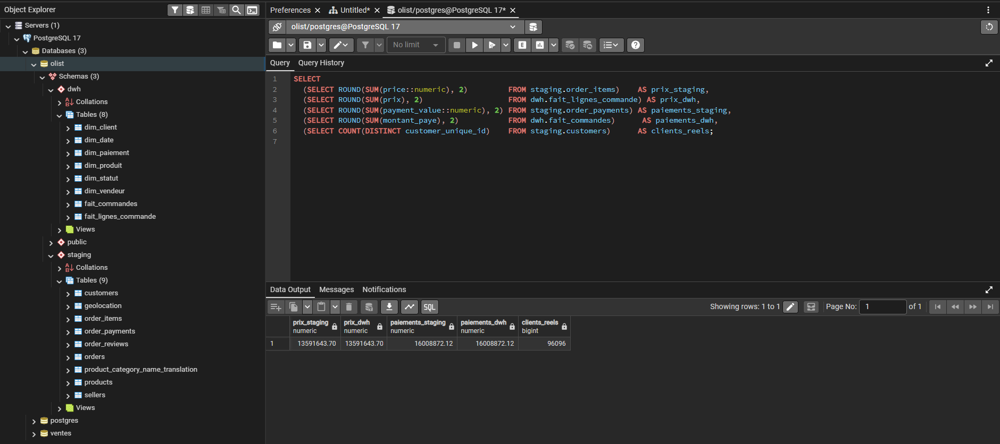

The report's two main results, recomputed directly in SQL: review score by delivery status, and seller revenue concentration (window functions).

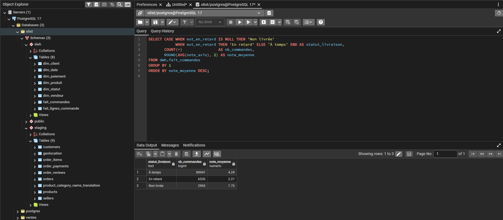

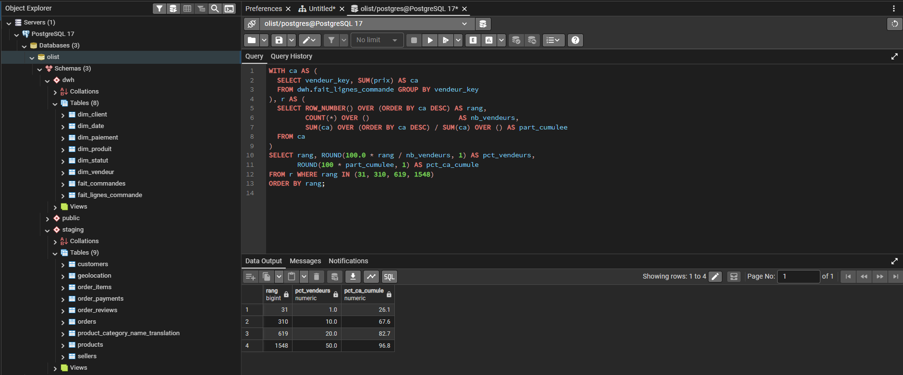

## 3. Key figures

| Metric | Value |
|---|---:|
| Product revenue | R$ 13,591,643.70 |
| Shipping fees | R$ 2,251,909.54 (14.2% of the amount billed) |
| Total amount paid | R$ 16,008,872.12 |
| Orders | 99,441, of which 96,478 delivered (97.0%) |
| Average basket | R$ 137.75 |
| Average item price | R$ 120.65 |
| Unique customers | 96,096 |
| Active sellers | 3,095 |
| Average delivery time | 12.56 days |
| Late delivery rate | 6.77% of delivered orders |
| Average review score | 4.09 / 5 |
| Negative reviews (1 or 2 stars) | 14.69% |

## 4. Sales

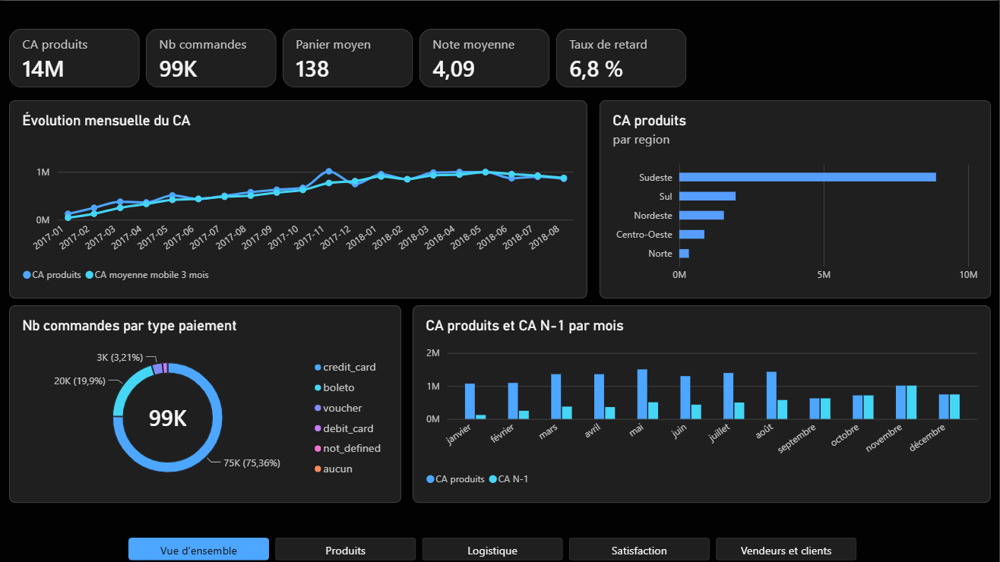

*Overview page. Monthly revenue (January 2017 to August 2018) grows from about R$ 0.1 M to R$ 1 M per month, peaking in November 2017. The Southeast dominates revenue by region, and credit cards cover three orders out of four.*

- **Growth.** 2017 revenue: R$ 6.16 M. January–August 2018 revenue: R$ 7.39 M, **+137%** on the same period. Monthly revenue levels off at around **R$ 1 M** from March 2018.
- **Black Friday.** November 2017 is the best month (R$ 1.01 M). **24 November 2017** alone accounts for 1,166 orders and R$ 152,654, about **4.5 times** an average day of the same month.
- **Categories.** 74 categories are sold, but the top 10 make **62% of revenue**. The leaders are *health_beauty* (R$ 1.26 M, 9.3%), *watches_gifts* (R$ 1.21 M) and *bed_bath_table* (R$ 1.04 M).
- **Price and categories.** *watches_gifts* sells fewer items than *bed_bath_table* (5,624 orders against 9,417), at twice the average price (R$ 201 against R$ 93).
- **Payment.** Credit cards cover **75.4%** of orders, with 3.6 instalments on average. *Boleto*, a Brazilian bank payment slip, covers **19.9%**. Paying in instalments is therefore central to the buying journey.

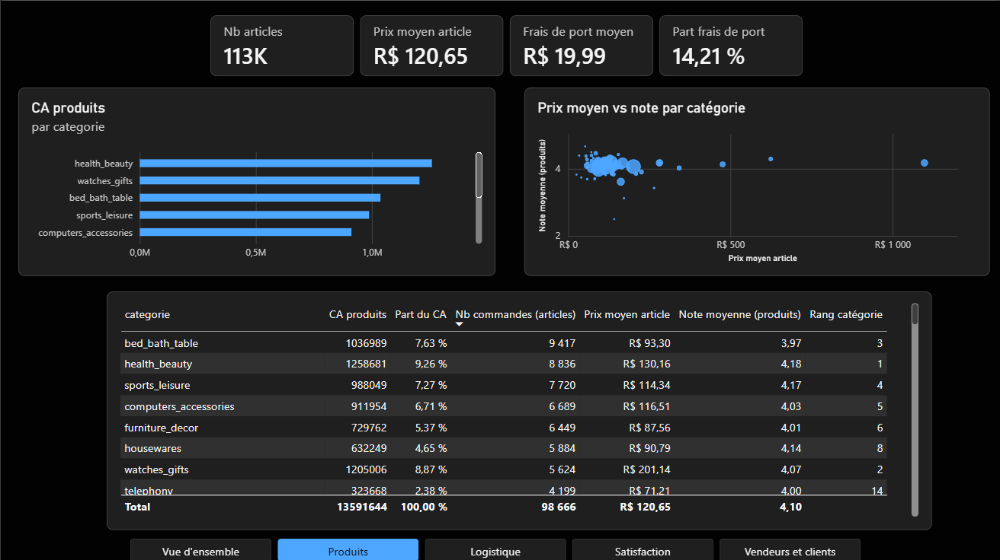

*Products page. The scatter plot crosses average price and review score by category: the score stays close to 4 whatever the price. Price does not explain dissatisfaction.*

## 5. Logistics

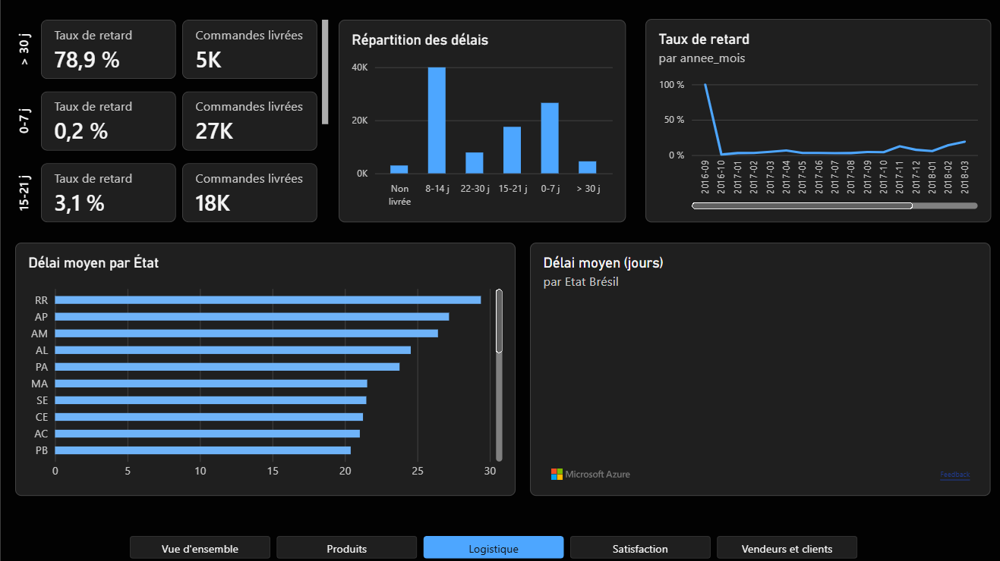

*Logistics page. On the left, the late rate by delivery-time band (0.2% under 8 days, 78.9% beyond 30 days). In the centre, the number of orders per band. On the right, the monthly late rate. At the bottom, average delivery time by customer state.*

- **Long deliveries are late deliveries.** The late rate is 0.2% for orders delivered within 7 days. It reaches **25.9%** between 22 and 30 days, and **78.8%** beyond 30 days.
- **Promised dates are very cautious.** On average, a delivered order arrives **11.9 days before** its estimated date. Despite that margin, 6.8% of orders are late.
- **Regional gaps.**

  | Customer region | Average delivery time | Late rate |
  |---|---:|---:|
  | Southeast (Sudeste) | 10.8 days | 6.1% |
  | South (Sul) | 14.0 days | 5.9% |
  | Centre-West (Centro-Oeste) | 15.0 days | 6.5% |
  | Northeast (Nordeste) | 20.0 days | 12.7% |
  | North (Norte) | 22.6 days | 8.6% |

  By state, delivery times range from **8.8 days in São Paulo** to **29.4 days in Roraima**. The Northeast combines long delays with frequent lateness: Alagoas 21.4%, Maranhão 17.4%.
- **Likely cause.** **73.9%** of sellers are based in the Southeast, while orders come from the whole country. Parcels to the North and Northeast travel long distances.
- **Lateness peaks.** The monthly late rate climbs to **12.4% in November 2017**, after Black Friday, then to **14.1% in February 2018** and **19.0% in March 2018**. The rest of the time it stays between 1% and 7%.

## 6. Customer satisfaction

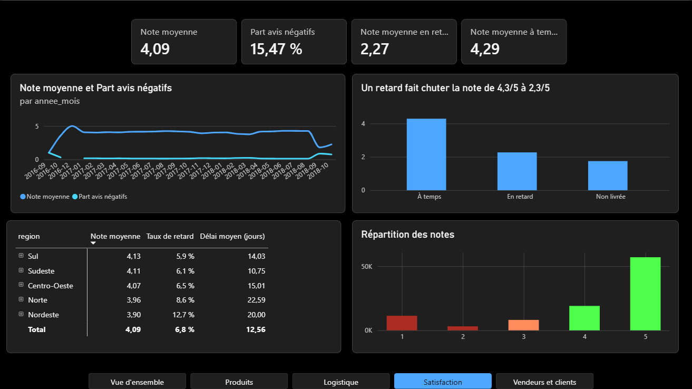

*Satisfaction page. Top right, the average score by delivery status. Bottom right, the score distribution, dominated by 5-star reviews but with a spike at 1 star. The table compares score, lateness and delivery time by region.*

- **Score distribution.** 57.8% of reviews give 5 stars and 19.3% give 4 stars, but **11.5% give 1 star**. The distribution is polarised.
- **Impact of lateness.**

  | Delivery status | Average score |
  |---|---:|
  | On time | 4.29 |
  | Late | 2.27 |
  | Not delivered | 1.75 |

  Scores fall as delivery time grows: **4.42** under 8 days, **3.60** between 22 and 30 days, **2.25** beyond 30 days.
- **Lateness peaks show up in the scores.** The monthly score drops to **3.99** in November 2017, then to **3.88** and **3.81** in February and March 2018. These are exactly the peak lateness months. It climbs back above 4.2 once delivery times return to normal.
- **By region**, the two slowest regions also have the lowest scores: Northeast 3.90 and North 3.96, against 4.11 for the Southeast.

## 7. Sellers and customers

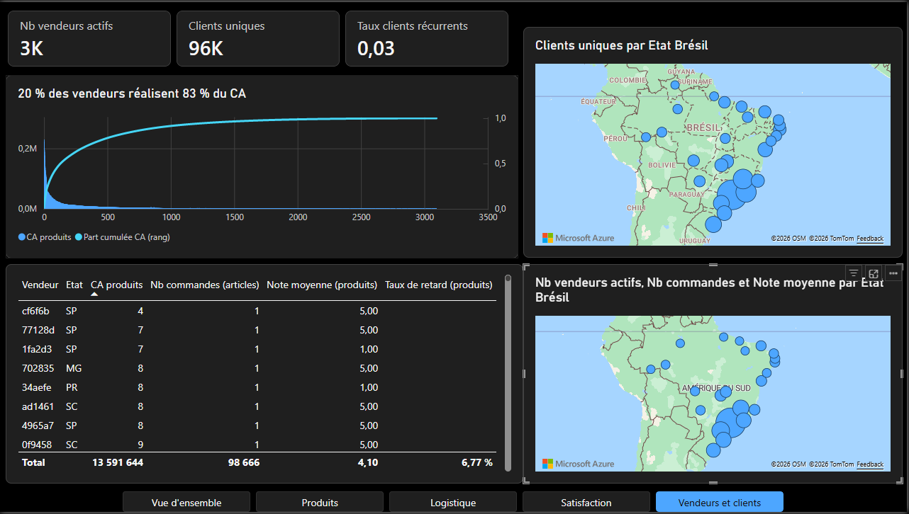

*Sellers and customers page. The Pareto curve (sellers ranked by descending revenue) rises very fast, then flattens. The two maps show customers and sellers concentrated in the Southeast.*

- **Seller concentration (Pareto).**

  | Share of sellers | Cumulative share of revenue |
  |---:|---:|
  | 1% (31 sellers) | 26.1% |
  | 10% | 67.6% |
  | 20% | **82.7%** |
  | 50% | 96.8% |

  Half of the sellers share less than 4% of revenue.
- **Top seller profiles.** The two largest sellers have similar revenue, about R$ 225,000 each. One gets there with 1,132 orders. The other, based in Bahia, needs only 358 orders because it sells expensive items.
- **Customers.** 96,096 unique customers, concentrated in the Southeast (65% of revenue, 38% from São Paulo state alone). Only **2,997 customers (3.1%)** ordered more than once. The most loyal customer placed 17 orders.

## 8. My recommendations

1. **Make delivery reliable outside the Southeast.** Pickup points or warehouses in the Northeast, and regional carriers for the North. This is the main lever on review scores and negative reviews.
2. **Prepare for activity peaks.** Plan logistics capacity for Black Friday and the start of the year, when lateness rose two- to threefold.
3. **Recruit sellers in the North and Northeast.** This brings supply closer to customers and reduces dependence on the largest sellers, since 20% of them make 83% of revenue.
4. **Launch a retention programme.** With 3% repeat customers, growth relies almost entirely on acquisition. Two possible levers: an email after a successful delivery, and a voucher for the second order.
5. **Follow up on late orders.** A proactive message and a goodwill gesture as soon as an order passes its estimated date could limit 1-star reviews.

## 9. Limitations

- Data for 2016 and September–October 2018 is incomplete. Trends cover January 2017 to August 2018.
- Revenue here is the **item price**, excluding shipping. The amount paid (R$ 16.0 M) includes shipping and instalment interest.
- An order can contain items from several sellers. Review score and lateness are measured **at order level**, then attributed to every seller or category in the order.
- Geographic coordinates are averaged by postal code prefix.
- The dashboard labels are in French (*CA* = revenue, *commandes* = orders, *note* = review score, *retard* = late delivery).
