# Olist : analyse des ventes, de la logistique et de la satisfaction client

*Rapport d'analyse · **[Ton nom complet]** · Données : Olist Brazilian E-Commerce (Kaggle) · Montants en réais (R$), prix des articles hors frais de port*

[English version](analysis_report_en.md) · [README](../README.md)

---

## 1. Résumé

Olist est une place de marché brésilienne qui met en relation de petits vendeurs et des clients particuliers. Le jeu de données couvre **99 441 commandes** passées de septembre 2016 à octobre 2018, pour **13,59 M R$** de chiffre d'affaires produits.

Les cinq conclusions principales de mon analyse :

1. **La croissance est forte** : le CA de janvier à août 2018 est **2,4 fois** celui de la même période en 2017 (+137 %).
2. **Le retard de livraison détruit la satisfaction.** Une commande livrée à temps obtient en moyenne **4,29/5**, une commande en retard **2,27/5**.
3. **La géographie explique les délais.** 74 % des vendeurs sont dans le Sudeste. Un client du Norte attend en moyenne **22,6 jours**, contre **10,8 jours** dans le Sudeste.
4. **Le CA est très concentré** : **20 % des vendeurs** réalisent **83 % du CA**.
5. **Les clients ne reviennent presque pas** : seuls **3,1 %** des clients ont passé plus d'une commande.

## 2. Données et méthode

| Étape | Outil | Résultat |
|---|---|---|
| Données brutes | 9 CSV Kaggle | 1,55 million de lignes, dont 1 million de géolocalisation |
| Contrôle qualité | Python (pandas) | [rapport_qualite.md](rapport_qualite.md) |
| Staging | PostgreSQL 17 | copie brute des 9 fichiers |
| Entrepôt | ETL Python vers le schéma `dwh` | modèle en étoile : 6 dimensions, 2 tables de faits |
| Contrôles | SQL | 6 contrôles automatiques et des valeurs de référence pour chaque KPI |
| Restitution | Power BI, 34 mesures DAX | dashboard de 5 pages |

Mes principaux choix de modélisation :

- **Client réel = `customer_unique_id`.** `customer_id` change à chaque commande. L'utiliser donnerait 99 441 « clients » au lieu de 96 096 et masquerait totalement la fidélité.
- **Deux tables de faits.** `fait_lignes_commande` est au grain article (112 650 lignes) : elle porte le CA, les catégories et les vendeurs. `fait_commandes` est au grain commande (99 441 lignes) : elle porte les paiements, les délais et les avis. Paiements et avis ne sont jamais joints au grain article, ce qui évite de compter un même montant plusieurs fois.
- **J'ai vérifié chaque mesure DAX** contre une requête SQL indépendante ([valeurs_reference.md](valeurs_reference.md)).
- **Période d'analyse : janvier 2017 à août 2018.** Les mois de 2016 et ceux de septembre-octobre 2018 ne contiennent que quelques commandes. Ils produisent des valeurs extrêmes, par exemple une note moyenne de 1,0 en septembre 2016 pour une seule commande.

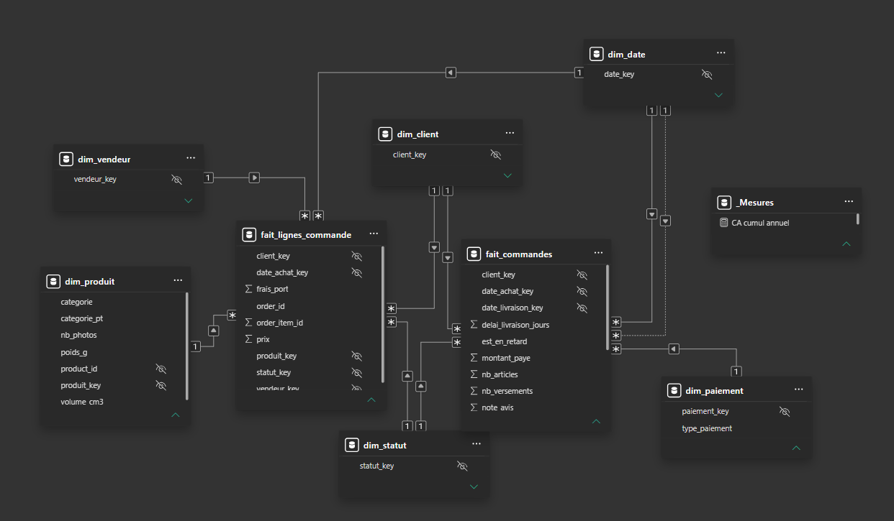

### Vérification dans PostgreSQL

Les deux schémas de la base : `staging` contient la copie brute des 9 fichiers, `dwh` le modèle en étoile de 8 tables.

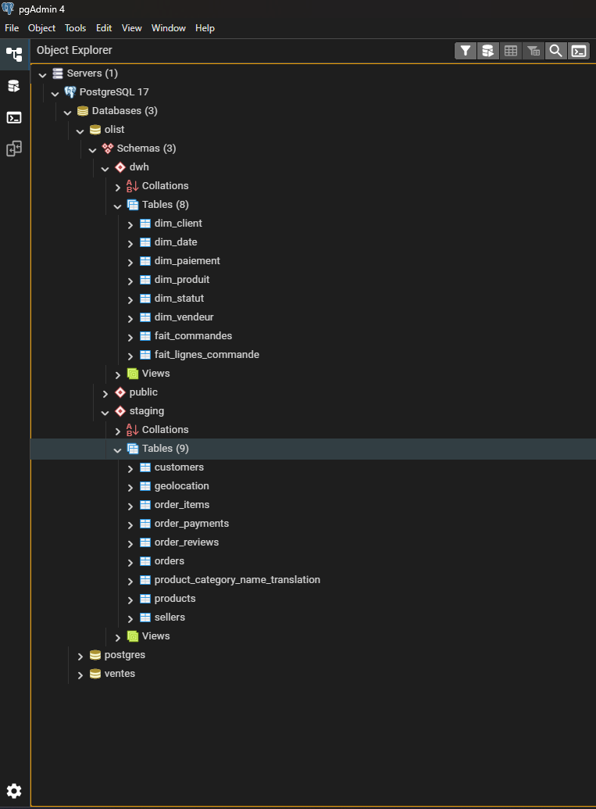

Le diagramme généré par pgAdmin montre les clés étrangères réellement déclarées. Les deux tables de faits pointent vers les mêmes dimensions, et `fait_commandes` est reliée deux fois à `dim_date` (date d'achat et date de livraison).

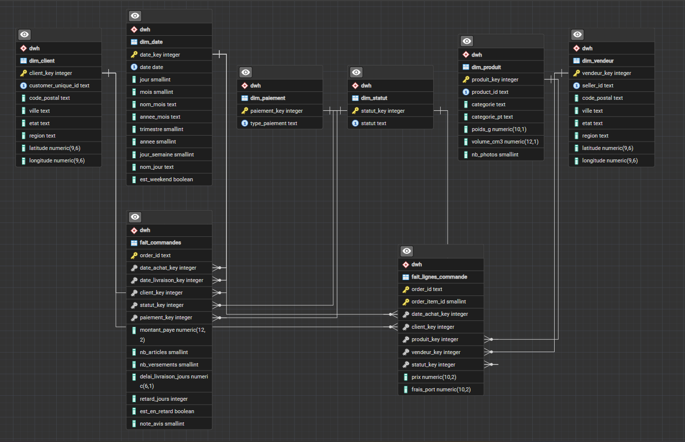

**Aucune ligne perdue.** Staging et entrepôt contiennent le même nombre de commandes (99 441) et d'articles (112 650). `dim_client` compte 96 097 lignes : les 96 096 clients réels plus le membre « inconnu ».

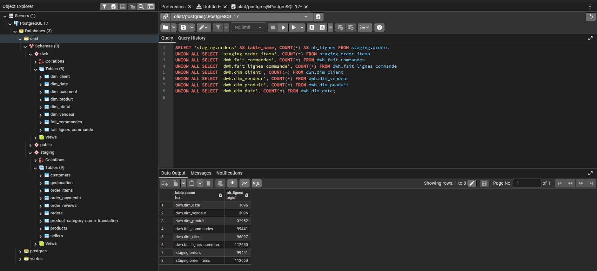

**Aucun montant perdu ni dupliqué.** La somme des prix (13 591 643,70 R$) et celle des paiements (16 008 872,12 R$) sont identiques avant et après transformation. Le nombre de clients réels est de 96 096.

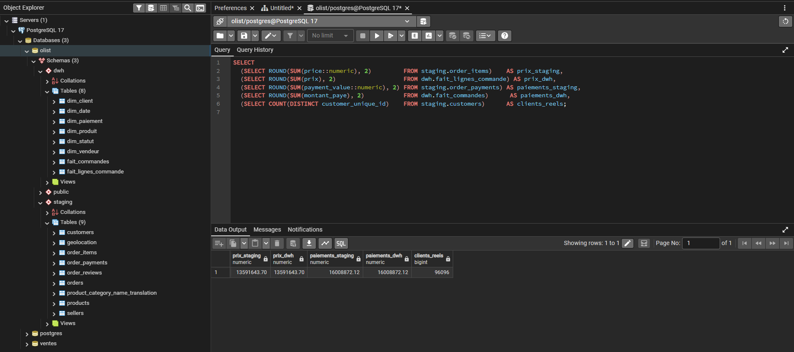

Les deux résultats principaux du rapport, recalculés directement en SQL : la note selon le statut de livraison, et la concentration du CA des vendeurs (fonctions de fenêtre).

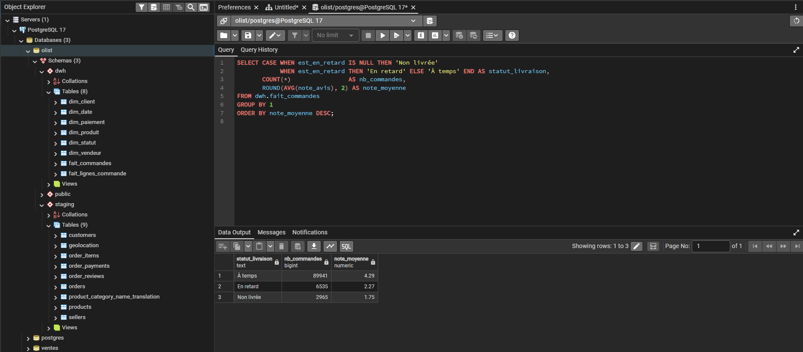

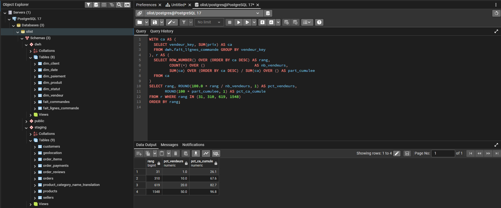

## 3. Chiffres clés

| Indicateur | Valeur |
|---|---:|
| CA produits | 13 591 643,70 R$ |
| Frais de port | 2 251 909,54 R$ (14,2 % du total facturé) |
| Montant total payé | 16 008 872,12 R$ |
| Commandes | 99 441, dont 96 478 livrées (97,0 %) |
| Panier moyen | 137,75 R$ |
| Prix moyen d'un article | 120,65 R$ |
| Clients uniques | 96 096 |
| Vendeurs actifs | 3 095 |
| Délai moyen de livraison | 12,56 jours |
| Taux de retard | 6,77 % des commandes livrées |
| Note moyenne | 4,09 / 5 |
| Avis négatifs (1 ou 2 étoiles) | 14,69 % |

## 4. Ventes

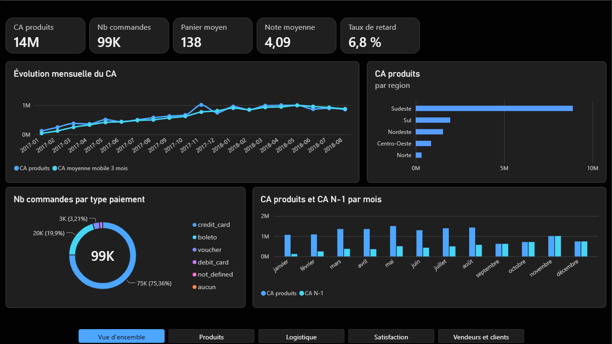

*Page « Vue d'ensemble ». La courbe du CA mensuel (janvier 2017 à août 2018) passe d'environ 0,1 M R$ à 1 M R$ par mois, avec le pic de novembre 2017. Le Sudeste domine le CA par région, et la carte de crédit couvre trois commandes sur quatre.*

- **Croissance.** CA 2017 : 6,16 M R$. CA de janvier à août 2018 : 7,39 M R$, soit **+137 %** sur la même période. Le CA mensuel se stabilise autour de **1 M R$** à partir de mars 2018.
- **Black Friday.** Novembre 2017 est le meilleur mois (1,01 M R$). Le **24 novembre 2017** à lui seul compte 1 166 commandes et 152 654 R$, environ **4,5 fois** un jour moyen du même mois.
- **Catégories.** 74 catégories sont vendues, mais les 10 premières font **62 % du CA**. En tête : *health_beauty* (1,26 M R$, 9,3 %), *watches_gifts* (1,21 M R$) et *bed_bath_table* (1,04 M R$).
- **Prix et catégories.** *watches_gifts* vend moins d'articles que *bed_bath_table* (5 624 commandes contre 9 417), mais à un prix moyen deux fois plus élevé (201 R$ contre 93 R$).
- **Paiement.** La carte de crédit couvre **75,4 %** des commandes, avec 3,6 versements en moyenne. Le boleto, un bordereau bancaire brésilien, en couvre **19,9 %**. Le paiement en plusieurs fois est donc central dans le parcours d'achat.

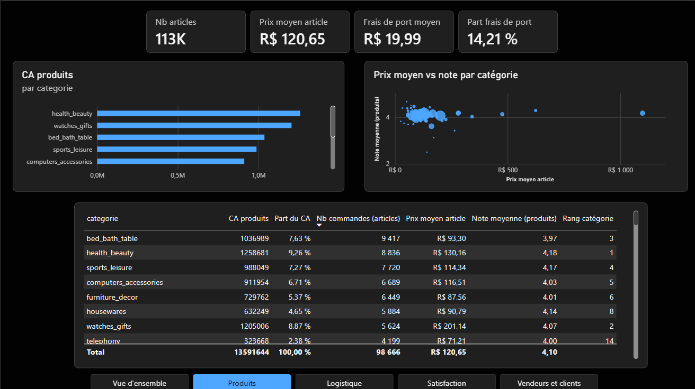

*Page « Produits ». Le nuage de points croise prix moyen et note par catégorie : la note reste proche de 4 quel que soit le prix. Le prix n'explique donc pas l'insatisfaction.*

## 5. Logistique

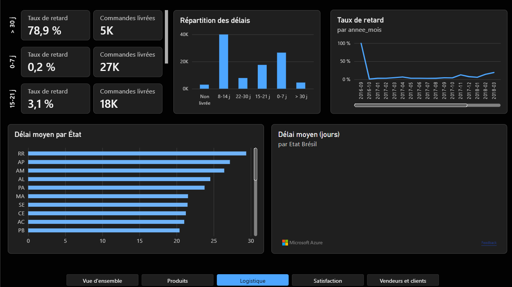

*Page « Logistique ». À gauche, le taux de retard par tranche de délai (0,2 % sous 8 jours, 78,9 % au-delà de 30 jours). Au centre, le nombre de commandes par tranche. À droite, l'évolution mensuelle du retard. En bas, le délai moyen par État du client.*

- **Le délai fait le retard.** Le taux de retard est de 0,2 % pour les commandes livrées en moins de 8 jours. Il atteint **25,9 %** entre 22 et 30 jours et **78,8 %** au-delà de 30 jours.
- **Les dates promises sont très prudentes.** En moyenne, une commande livrée arrive **11,9 jours avant** la date estimée. Malgré cette marge, 6,8 % des commandes sont en retard.
- **Inégalités régionales.**

  | Région du client | Délai moyen | Taux de retard |
  |---|---:|---:|
  | Sudeste | 10,8 j | 6,1 % |
  | Sul | 14,0 j | 5,9 % |
  | Centro-Oeste | 15,0 j | 6,5 % |
  | Nordeste | 20,0 j | 12,7 % |
  | Norte | 22,6 j | 8,6 % |

  Par État, les extrêmes vont de **8,8 jours à São Paulo** à **29,4 jours dans le Roraima**. Le Nordeste cumule délais longs et retards fréquents : Alagoas 21,4 %, Maranhão 17,4 %.
- **Cause probable.** **73,9 %** des vendeurs sont installés dans le Sudeste, mais ce sont des clients de tout le pays qui commandent. Les colis vers le Nord et le Nord-Est parcourent de longues distances.
- **Pics de retard.** Le taux mensuel monte à **12,4 % en novembre 2017**, après le Black Friday, puis à **14,1 % en février 2018** et **19,0 % en mars 2018**. Le reste du temps, il se situe entre 1 et 7 %.

## 6. Satisfaction client

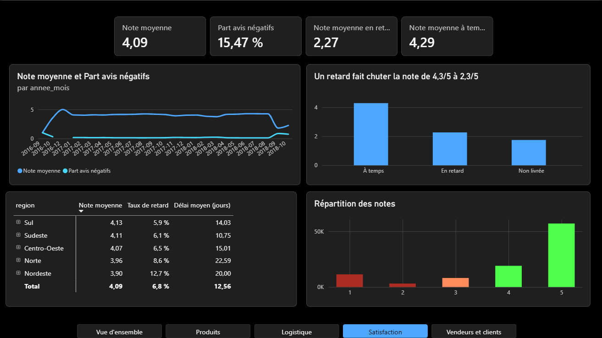

*Page « Satisfaction ». En haut à droite, la note moyenne selon le statut de livraison. En bas à droite, la répartition des notes, dominée par les 5 étoiles mais avec un pic à 1 étoile. Le tableau compare note, retard et délai par région.*

- **Répartition des notes.** 57,8 % de 5 étoiles et 19,3 % de 4 étoiles, mais aussi **11,5 % de 1 étoile**. La distribution est polarisée.
- **Effet du retard.**

  | Statut de la livraison | Note moyenne |
  |---|---:|
  | À temps | 4,29 |
  | En retard | 2,27 |
  | Non livrée | 1,75 |

  La note baisse avec le délai : **4,42** sous 8 jours, **3,60** entre 22 et 30 jours, **2,25** au-delà de 30 jours.
- **Les pics de retard se voient dans les notes.** La note mensuelle tombe à **3,99** en novembre 2017, puis à **3,88** et **3,81** en février et mars 2018. Ce sont exactement les mois de pic de retard. Elle remonte au-dessus de 4,2 dès que les délais se normalisent.
- **Par région**, les deux régions les plus lentes ont aussi les notes les plus basses : Nordeste 3,90 et Norte 3,96, contre 4,11 pour le Sudeste.

## 7. Vendeurs et clients

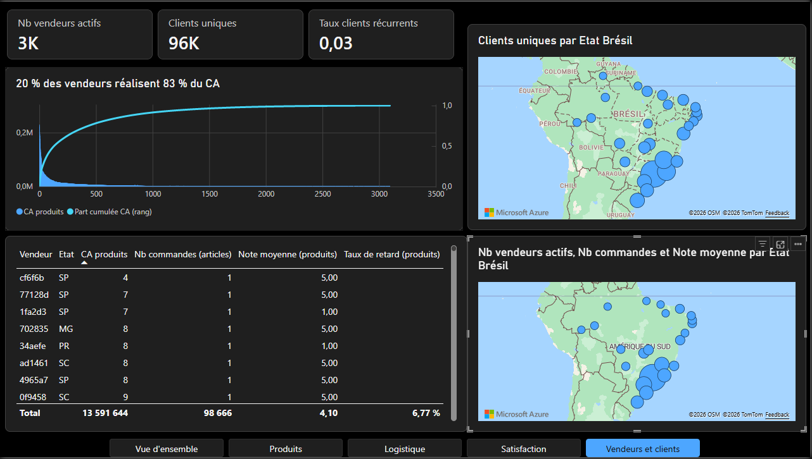

*Page « Vendeurs et clients ». La courbe de Pareto (vendeurs classés par CA décroissant) monte très vite puis s'aplatit. Les deux cartes montrent la concentration des clients et des vendeurs dans le Sud-Est.*

- **Concentration des vendeurs (Pareto).**

  | Part des vendeurs | Part cumulée du CA |
  |---:|---:|
  | 1 % (31 vendeurs) | 26,1 % |
  | 10 % | 67,6 % |
  | 20 % | **82,7 %** |
  | 50 % | 96,8 % |

  La moitié des vendeurs se partage moins de 4 % du CA.
- **Profils de gros vendeurs.** Les deux premiers vendeurs ont un CA proche, d'environ 225 000 R$ chacun. L'un l'obtient avec 1 132 commandes. L'autre, installé à Bahia, avec seulement 358 commandes, en vendant des articles chers.
- **Clients.** 96 096 clients uniques, concentrés dans le Sudeste (65 % du CA, dont 38 % pour l'État de São Paulo). Seuls **2 997 clients (3,1 %)** ont commandé plus d'une fois. Le client le plus fidèle a passé 17 commandes.

## 8. Mes recommandations

1. **Fiabiliser les délais hors Sudeste.** Points relais ou entrepôts dans le Nordeste, et transporteurs régionaux pour le Norte. C'est le principal levier sur la note et sur les avis négatifs.
2. **Préparer les pics d'activité.** Prévoir la capacité logistique pour le Black Friday et le début d'année, où le retard a été multiplié par 2 à 3.
3. **Recruter des vendeurs dans le Nord et le Nord-Est.** Cela rapproche l'offre des clients et réduit la dépendance aux plus gros vendeurs, puisque 20 % d'entre eux font 83 % du CA.
4. **Lancer un programme de fidélisation.** Avec 3 % de clients récurrents, la croissance repose presque entièrement sur l'acquisition. Deux leviers possibles : un e-mail après une livraison réussie, et un bon d'achat pour la deuxième commande.
5. **Suivre les commandes en retard.** Un message proactif et un geste commercial dès qu'une commande dépasse sa date estimée peuvent limiter les notes de 1 étoile.

## 9. Limites

- Les données de 2016 et de septembre-octobre 2018 sont incomplètes. Les tendances portent sur janvier 2017 à août 2018.
- Le CA présenté est le **prix des articles**, sans frais de port. Le montant payé (16,0 M R$) inclut frais de port et intérêts des paiements en plusieurs fois.
- Une commande peut contenir des articles de plusieurs vendeurs. La note et le retard sont mesurés **au niveau de la commande**, puis attribués à chaque vendeur ou catégorie présent dans la commande.
- Les coordonnées géographiques sont une moyenne par préfixe de code postal.
